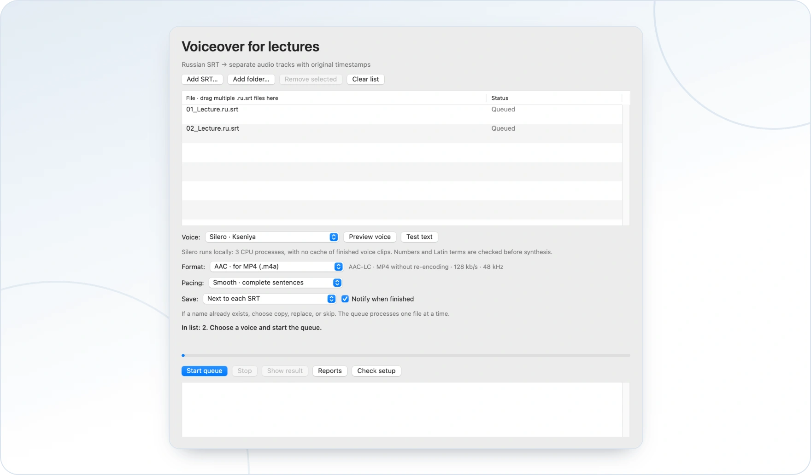

<!-- ppk-readme:head:start -->
<a href="https://popovantondev.github.io/SRTtoSound/index-en.html"><picture><source media="(prefers-color-scheme: dark)" srcset="https://raw.githubusercontent.com/popovantondev/SRTtoSound/main/docs/readme/header-en-dark.9999a60e.svg"></picture></a>
<!-- ppk-readme:head:end -->

# SRT to Sound

[Русский](README.ru.md) · [Deutsch](README.md) · **English**

<!-- ppk-readme:body:start -->

<a href="https://github.com/popovantondev/SRTtoSound/releases/tag/v3.5.0"><picture><source media="(prefers-color-scheme: dark)" srcset="https://raw.githubusercontent.com/popovantondev/SRTtoSound/main/docs/readme/btn-download-en-dark.4a2095cd.svg"></picture></a>
<a href="https://popovantondev.github.io/SRTtoSound/index-en.html"><picture><source media="(prefers-color-scheme: dark)" srcset="https://raw.githubusercontent.com/popovantondev/SRTtoSound/main/docs/readme/btn-website-en-dark.ead543c0.svg"></picture></a>
<a href="https://popovantondev.github.io/SRTtoSound/Guide-en.html"><picture><source media="(prefers-color-scheme: dark)" srcset="https://raw.githubusercontent.com/popovantondev/SRTtoSound/main/docs/readme/btn-guide-en-dark.2dd56809.svg"></picture></a>
<a href="https://github.com/popovantondev/SRTtoSound/issues/new/choose"><picture><source media="(prefers-color-scheme: dark)" srcset="https://raw.githubusercontent.com/popovantondev/SRTtoSound/main/docs/readme/btn-bug-en-dark.738180f9.svg"></picture></a>

<a href="https://raw.githubusercontent.com/popovantondev/SRTtoSound/main/docs/screenshots/interface-en.png"><picture><source media="(prefers-color-scheme: dark)" srcset="https://raw.githubusercontent.com/popovantondev/SRTtoSound/main/docs/readme/preview-en-dark.71d51977.webp"></picture></a> 
<a href="https://raw.githubusercontent.com/popovantondev/SRTtoSound/main/docs/screenshots/interface-en.png">Full screenshot</a>

<picture><source media="(prefers-color-scheme: dark)" srcset="https://raw.githubusercontent.com/popovantondev/SRTtoSound/main/docs/readme/divider-dark.4bfba62c.svg"></picture>
<!-- ppk-readme:body:end -->

<!-- public-release:start -->
Create synchronized Russian narration from finished SRT subtitles as M4A or WAV.

**macOS 15+ · Apple Silicon · Release 3.5.0**

**[Download](https://github.com/popovantondev/SRTtoSound/releases/tag/v3.5.0)** · **[User guide](https://popovantondev.github.io/SRTtoSound/Guide-en.html)** · **[Report a problem](https://github.com/popovantondev/SRTtoSound/issues/new/choose)**

**Requirements and limitations:** Install Python 3.12 ARM64, FFmpeg, Silero packages and v5_5_ru.pt separately; they are not bundled. Not notarized by Apple.

**First steps:** Extract the app and complete dependency setup in the guide first. Add .ru.srt files and choose voice, format and output folder.

**Application files:**

- [`SRT-to-Sound-3.5.0-macOS-arm64.zip`](https://github.com/popovantondev/SRTtoSound/releases/download/v3.5.0/SRT-to-Sound-3.5.0-macOS-arm64.zip)

**Checksums:** [`SHA256SUMS`](https://github.com/popovantondev/SRTtoSound/releases/download/v3.5.0/SHA256SUMS)
<!-- public-release:end -->

## Quick start

Download the current 3.5.0 release archive, extract it, and read the release notes before use. Before synthesizing speech, follow the [English installation guide](docs/INSTALLATION.en.md) to install FFmpeg, the separate Python/Silero environment, and the model. Then add final Russian subtitle files (`.ru.srt`) or a folder. Select one of five Silero voices (Kseniya is the default), AAC/M4A or WAV, and an output location. The source SRT remains unchanged.

The project processes subtitles locally. It has no Siri or macOS system-voice synthesis path.

### Dependencies and first output

FFmpeg, a separate Python 3.12 ARM64 environment, and the Silero `v5_5_ru.pt` model are required and set up separately. They are not included in the app bundle. The release archive includes the pinned dependency list, but not the installed packages or model weights. The app does not download or install dependencies during synthesis. This project adopts a strict personal, non-commercial-only use scope for Silero; model weights are not redistributed. Read the [English installation guide](docs/INSTALLATION.en.md) and [third-party notices](THIRD_PARTY.en.md) before use.

The software requires macOS 15+ and Apple silicon. Releases are not notarized; macOS may display a security warning. The [installation guide](docs/INSTALLATION.en.md) explains checksum verification and Apple's one-app security flow. Never disable macOS security globally, and do not open an archive whose checksum does not match.

## User documentation

- [English changelog](CHANGELOG.en.md)
- [Third-party notices and model terms](THIRD_PARTY.en.md)
- [Rights](RIGHTS.en.md)

## Developer documentation

Follow the [English build and test guide](docs/BUILD.en.md). It explains the safe build output, test commands, and release-packaging boundary.

## Reports

Before filing an issue, replace real names and content with synthetic examples. Remove personal information, private subtitles, audio/video, logs, absolute paths, usernames, and machine-specific voice/model details. Use the [English bug-report form](https://github.com/popovantondev/SRTtoSound/issues/new?template=bug_report.yml) or [feature-request form](https://github.com/popovantondev/SRTtoSound/issues/new?template=feature_request.yml); both have localized alternatives. Screenshots must show only synthetic files.

## Downloads and rights

Download the current macOS release, source archive, and SHA-256 checksums from [SRT to Sound 3.5.0](https://github.com/popovantondev/SRTtoSound/releases/tag/v3.5.0). The app is ad-hoc signed and not notarized; FFmpeg, Python 3.12 ARM64, Silero packages, and model weights must be installed separately. Read the [English rights notice](RIGHTS.en.md) and [third-party notices](THIRD_PARTY.en.md) before use.
