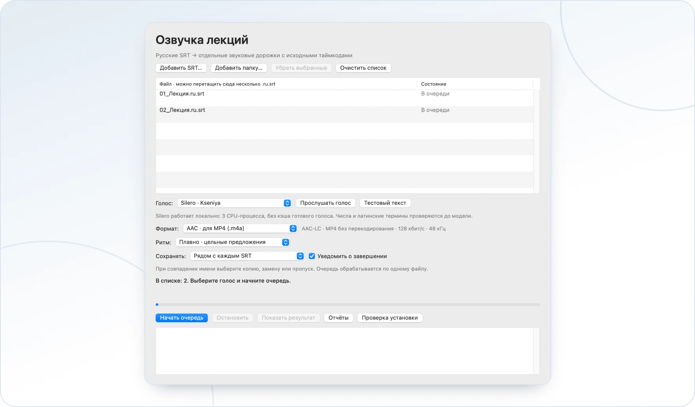

<!-- ppk-readme:head:start -->
<a href="https://popovantondev.github.io/SRTtoSound/index-ru.html"><picture><source media="(prefers-color-scheme: dark)" srcset="https://raw.githubusercontent.com/popovantondev/SRTtoSound/main/docs/readme/header-ru-dark.20cbc597.svg"></picture></a>
<!-- ppk-readme:head:end -->

# SRT to Sound

**Русский** · [Deutsch](README.md) · [English](README.en.md)

<!-- ppk-readme:body:start -->

<a href="https://github.com/popovantondev/SRTtoSound/releases/tag/v3.5.0"><picture><source media="(prefers-color-scheme: dark)" srcset="https://raw.githubusercontent.com/popovantondev/SRTtoSound/main/docs/readme/btn-download-ru-dark.2644de6c.svg"></picture></a>
<a href="https://popovantondev.github.io/SRTtoSound/index-ru.html"><picture><source media="(prefers-color-scheme: dark)" srcset="https://raw.githubusercontent.com/popovantondev/SRTtoSound/main/docs/readme/btn-website-ru-dark.e9f56d87.svg"></picture></a>
<a href="https://popovantondev.github.io/SRTtoSound/Guide-ru.html"><picture><source media="(prefers-color-scheme: dark)" srcset="https://raw.githubusercontent.com/popovantondev/SRTtoSound/main/docs/readme/btn-guide-ru-dark.eccf87e7.svg"></picture></a>
<a href="https://github.com/popovantondev/SRTtoSound/issues/new/choose"><picture><source media="(prefers-color-scheme: dark)" srcset="https://raw.githubusercontent.com/popovantondev/SRTtoSound/main/docs/readme/btn-bug-ru-dark.a0f9e58f.svg"></picture></a>

<a href="https://raw.githubusercontent.com/popovantondev/SRTtoSound/main/docs/screenshots/interface-ru.png"><picture><source media="(prefers-color-scheme: dark)" srcset="https://raw.githubusercontent.com/popovantondev/SRTtoSound/main/docs/readme/preview-ru-dark.26bb84fe.webp"></picture></a> 
<a href="https://raw.githubusercontent.com/popovantondev/SRTtoSound/main/docs/screenshots/interface-ru.png">Снимок целиком</a>

<picture><source media="(prefers-color-scheme: dark)" srcset="https://raw.githubusercontent.com/popovantondev/SRTtoSound/main/docs/readme/divider-dark.4bfba62c.svg"></picture>
<!-- ppk-readme:body:end -->

<!-- public-release:start -->
Создаёт синхронизированную русскую озвучку из готовых SRT-субтитров в M4A или WAV.

**macOS 15+ · Apple Silicon · Выпуск 3.5.0**

**[Скачать](https://github.com/popovantondev/SRTtoSound/releases/tag/v3.5.0)** · **[Инструкция](https://popovantondev.github.io/SRTtoSound/Guide-ru.html)** · **[Сообщить об ошибке](https://github.com/popovantondev/SRTtoSound/issues/new/choose)**

**Требования и ограничения:** Отдельно установите Python 3.12 ARM64, FFmpeg, пакеты Silero и модель v5_5_ru.pt. Они не входят в архив. Приложение не нотарифицировано Apple.

**Первые шаги:** Распакуйте приложение и сначала выполните установку зависимостей по руководству. Добавьте .ru.srt, выберите голос, формат и выходную папку.

**Файлы приложения:**

- [`SRT-to-Sound-3.5.0-macOS-arm64.zip`](https://github.com/popovantondev/SRTtoSound/releases/download/v3.5.0/SRT-to-Sound-3.5.0-macOS-arm64.zip)

**Контрольные суммы:** [`SHA256SUMS`](https://github.com/popovantondev/SRTtoSound/releases/download/v3.5.0/SHA256SUMS)
<!-- public-release:end -->

## Быстрый запуск

Скачайте текущий выпуск 3.5.0, распакуйте архив и прочитайте примечания к версии перед использованием. Добавьте готовые русские субтитры `.ru.srt` или папку, выберите один из пяти голосов Silero (по умолчанию Kseniya), AAC/M4A или WAV и место сохранения. Исходный SRT не изменяется.

Обработка выполняется локально. Siri и синтез системными голосами macOS в эту версию не входят.

### Зависимости и первая дорожка

FFmpeg, отдельное окружение Python 3.12 ARM64 и модель Silero `v5_5_ru.pt` обязательны и настраиваются отдельно. Они не входят в пакет приложения; архив выпуска содержит список закреплённых зависимостей, но не установленные пакеты и веса модели. Перед первой озвучкой пройдите [инструкцию по установке](docs/INSTALLATION.md). Во время озвучки программа ничего не скачивает и не устанавливает. Для Silero мы фиксируем строгий режим: только личное некоммерческое использование; веса модели не распространяются. Прочитайте [уведомление о сторонних компонентах](THIRD_PARTY.ru.md).

Требуются macOS 15+ и Apple silicon. Выпуски не нотариально заверены; macOS может показать предупреждение безопасности. Перед запуском проверьте SHA-256 опубликованного архива. Обходите системные предупреждения только для проверенного выпуска, которому доверяете.

## Документы пользователя

- [Установка и первая дорожка](docs/INSTALLATION.md)
- [История изменений](CHANGELOG.md)
- [Сторонние компоненты и условия модели](THIRD_PARTY.ru.md)

## Документы разработчика

Следуйте [русской инструкции по сборке и тестам](docs/BUILD.md). В ней описаны команды проверки, безопасный каталог сборки и границы подготовки релиза.

## Сообщения об ошибках

Заменяйте настоящие имена и материалы синтетическими примерами. Удаляйте личные данные, приватные субтитры, аудио/видео, журналы, абсолютные пути, имена пользователей и настройки голосов/моделей конкретного компьютера. Используйте [русскую форму сообщения об ошибке](https://github.com/popovantondev/SRTtoSound/issues/new?template=bug_report_ru.yml) или [форму предложения функции](https://github.com/popovantondev/SRTtoSound/issues/new?template=feature_request_ru.yml). Формы локализованы и напоминают удалить личные данные. На снимках экрана должны быть только синтетические файлы.

## Загрузки и права

Скачать текущий выпуск для macOS, архив исходников и контрольные суммы SHA-256 можно на странице [SRT to Sound 3.5.0](https://github.com/popovantondev/SRTtoSound/releases/tag/v3.5.0). Приложение подписано локальной ad-hoc подписью и не нотарифицировано Apple; FFmpeg, Python 3.12 ARM64, пакеты Silero и веса модели устанавливаются отдельно. Перед использованием прочитайте [условия прав](RIGHTS.ru.md) и [уведомление о сторонних компонентах](THIRD_PARTY.ru.md).
